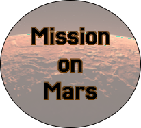

# Mission on Mars



**Sapienza University of Rome - Interactive Graphics Course Final Project**
Held by Prof. Marco Schaerf

## Live Demo and Links
**Play the Game Here:** [Live Demo](https://sapienzainteractivegraphicscourse.github.io/final-project-giacomobernardini/)
**GitHub Repository:** [GitHub Page](https://github.com/SapienzaInteractiveGraphicsCourse/final-project-giacomobernardini)
**Project Report:** [report.pdf](https://github.com/SapienzaInteractiveGraphicsCourse/final-project-giacomobernardini/blob/main/report.pdf)

*We recommend playing the game in full-screen mode for the best immersive experience.*

---

## Author
| Student | Matricola |
|---|---|
| Giacomo Bernardini | 2070434 |

---

## 1. Project Overview
**Mission on Mars** is an interactive 3D survival and exploration game developed entirely in **WebGL** and **Three.js**. Created as the final project for the Interactive Graphics course, it features a custom-built physics system, procedural animations, and a seamless transition between third-person driving and first-person shooter mechanics.

You are a lone commander stranded on the desolate surface of Mars after a catastrophic base failure. The Artificial Sun requires energy cores to reignite. But you are not alone... the sudden power fluctuations have awakened a voxel-based alien swarm beneath the Martian dust. Survive, restore the Artificial Sun, and escape!

---

## 2. Core Gameplay Mechanics

### The Rover & Resource Gathering
- **Third-Person Driving:** Navigate the dunes using a custom driving model that reacts to the procedural terrain's elevation and slope.
- **Magnetic Robotic Arm:** Use the UI sliders to manipulate the rover's articulated arm. Activate the electromagnet to pick up scattered energy batteries and drop them into the central deposit station's glowing hopper.
- **Radar System:** A dynamic UI radar guides the player toward the remaining batteries and, eventually, the extraction point.

### Interactive Environment
- **Dynamic Headlights:** The player can fully customize the rover's headlights using the HTML DOM interface, changing the light color, intensity, and toggling the power on or off to navigate the dark Martian surface.
- **Sandstorm & Visibility:** A custom procedural particle system simulates a continuous Martian sandstorm, reducing visibility and adding to the atmospheric tension.

### Combat Phase & The Alien Swarm
- **FPS Transition:** Once all batteries are collected, the game seamlessly locks the pointer and switches to a First-Person Shooter perspective.
- **The Swarm:** A horde of hierarchical, voxel-styled alien mechas spawns and begins hunting the rover. 
- **Combat System:** The player must defend the rover using a laser cannon. The weapon features a difficulty-scaled cooldown system, and enemies possess specific hitboxes (e.g., armor vs. weak-point headshots).

---

## 3. Controls

| Action | Command | 
|---|---|
| Drive forward / backward | **W / S** | 
| Steer left / right | **A / D** | 
| Toggle the robotic arm's Electromagnet (ON/OFF) | **Spacebar** | 
| Orbit the camera around the rover | **Mouse (Click & Drag)** | 
| Zoom in / out | **Mouse (Scroll)** | 
| Tweak headlight settings (color, intensity, power) | **UI Controls (on-screen HUD panel)** |
| Manually manipulate the robotic arm's joints | **UI Controls (on-screen HUD panel)** |
| Aim and Shoot (Combat Phase only) | **Mouse Movement & Left Click** |

---

## 4. Technical Architecture & Implementation

The project strictly adheres to the course constraints, relying on mathematical logic, custom AI, and code-driven animations rather than importing pre-made engine solutions.

### Rendering and Environment (Three.js)
- **Procedural Terrain:** The Martian surface is not a static model. It is generated mathematically using composite trigonometric functions (sine and cosine waves) to create rolling dunes and craters, rendered with flat shading for a stylized low-poly aesthetic.
- **Particle System:** The sandstorm is handled via an optimized Object Pool (`THREE.Points`), recycling particles that flow across the screen to simulate wind without degrading browser performance.

### Procedural Hierarchical Animations
All movements are procedurally coded in JavaScript:
- **The Robotic Arm:** Built using a rigid parent-child hierarchy (Forward Kinematics). Moving the base rotates the entire arm structure smoothly.
- **Adaptive Suspension:** Raycasters shoot downward from each wheel to read the procedural terrain's height in real-time, adjusting the suspension forks and tilting the rover's chassis (pitch and roll) accordingly.
- **Alien Locomotion:** The alien enemies are constructed from multiple distinct meshes (thorax, segmented legs, wings, mandibles). Their hovering, wing-flapping, and attacking gaits are driven by continuous mathematical functions linked to the `requestAnimationFrame` loop.
- **Native Procedural Death:** Alien defeats trigger a backward fall and a voxel-style particle burst.

### Custom Physics & Artificial Intelligence
- **Battery Physics:** When dropped, batteries undergo custom gravity and collision checks, allowing them to realistically slide or bounce off the edges of the extraction hopper.
- **Swarm AI:** The enemies utilize a custom movement algorithm. They continuously calculate the vector toward the player while simultaneously applying separation forces to avoid clumping together, and tangential forces to slide around environmental obstacles smoothly.

### Dynamic Lighting & Materials
- **PBR Texturing:** The environment and models utilize `MeshStandardMaterial` with customized Roughness and Metalness values to react realistically to the light.
- **Lighting Progression:** As the player deposits batteries, the global ambient and directional lighting progressively shifts, simulating the Artificial Sun.

---

## 5. Repository Structure

```text
final-project-giacomobernardini/
├── models/             # Static 3D assets (.glb files for wheels, batteries,...)
├── public/             # Static web assets (Logo)
├── music/             # Audio files for lasers, alien roars, music
├── textures/           # PBR Texture maps (Color, Normal, Roughness, Metalness)
├── src/                # Main Source Code
│   ├── main.js         # Game initialization, render loop, and combat logic
│   ├── setup.js        # Three.js scene, camera, and global lighting setup
│   ├── world.js        # Terrain generation, Alien hierarchical models, AI, and Sandstorm
│   ├── rover.js        # Rover assembly, suspension, and robotic arm kinematics
│   ├── ui.js           # DOM element bindings, state management, and HTML inputs
│   ├── particles.js    # Dust trail particle system (Object Pool)
│   ├── music.js        # Web Audio API management
|   └── style.css       # Custom HUD styling and dynamic cursors
├── index.html          # Main entry point and UI layout
└── README.md           # Project documentation
```

---

## 6. How to Run Locally

1. **Clone the repository:** `git clone https://github.com/SapienzaInteractiveGraphicsCourse/final-project-giacomobernardini.git`
2. **Navigate to the folder:** `cd final-project-giacomobernardini`
3. **Install dependencies:** `npm install`
4. **Start the development server:** `npm run dev`
5. **Play:** Open your browser and navigate to the local address provided in the terminal (usually `http://localhost:5173`).